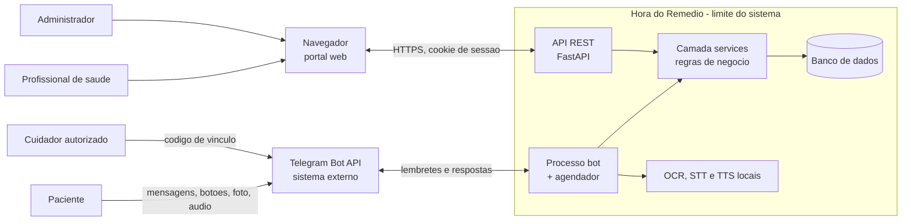
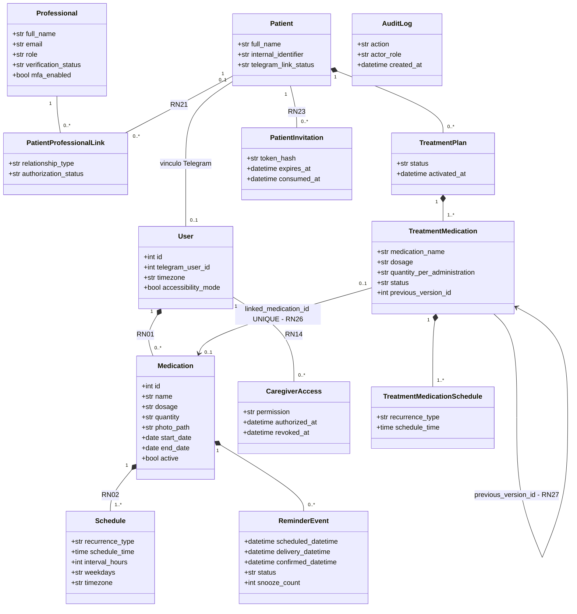
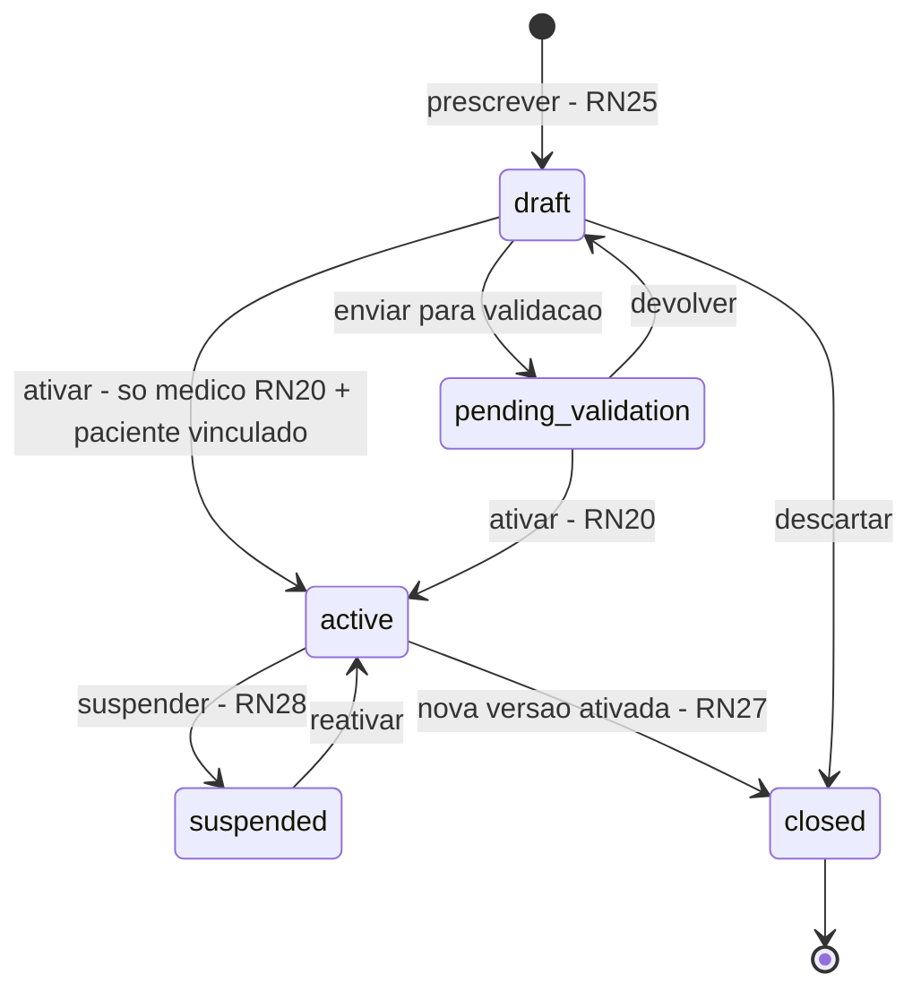
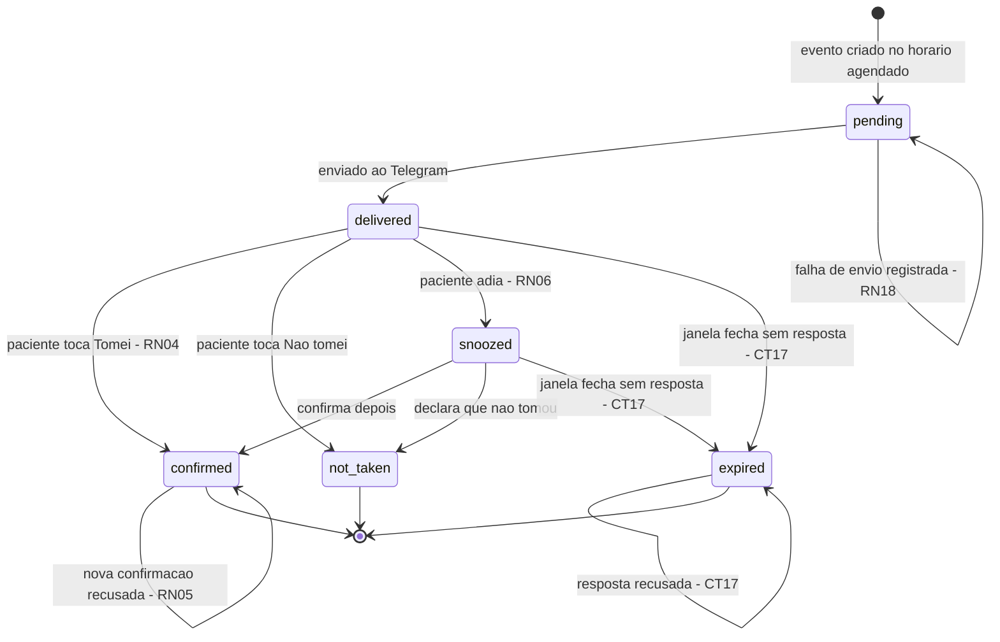
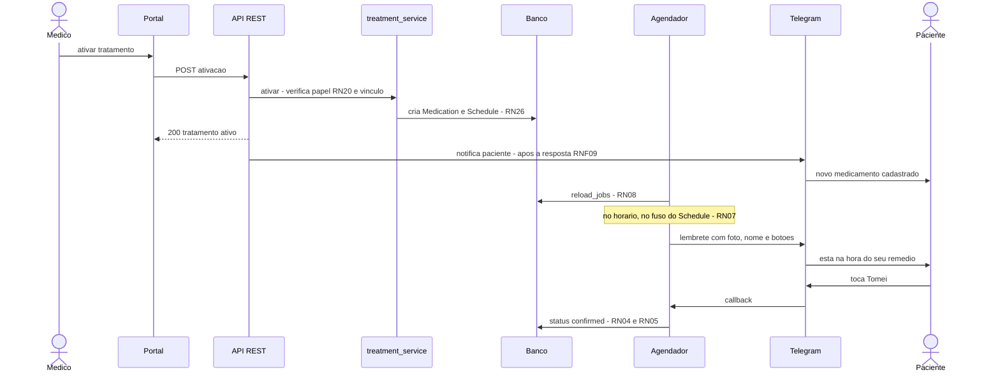
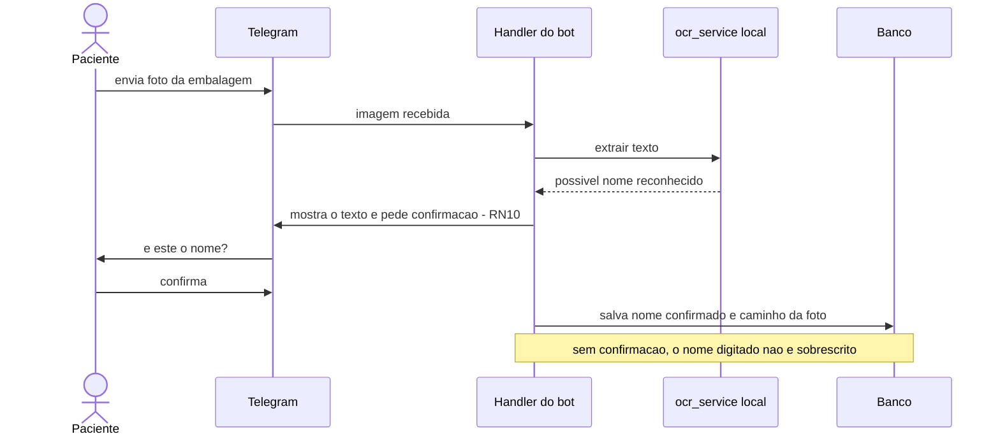

# Modelagem de Requisitos

O mesmo sistema visto por modelos, em vez de por tabelas de requisitos. Cada modelo responde a
uma pergunta diferente — e nenhum substitui os requisitos textuais.

---

## 1. As visões usadas e por quê

O Syllabus de Modelagem organiza a modelagem de requisitos em visões (§1.2, p. 11) e dedica um
capítulo a cada uma: contexto (cap. 2, p. 13), estrutura de informações (cap. 3, p. 16), visões
dinâmicas — casos de uso, fluxo e estados (cap. 4, p. 18) — e cenários (cap. 5, p. 23).

| Visão | Diagrama aqui | Pergunta que responde |
|---|---|---|
| **Contexto** | [Diagrama de contexto](#2-visão-de-contexto) | O que está dentro do sistema e o que é externo a ele? |
| **Estrutura de informações** | [Modelo de classes](#3-visão-de-estrutura-de-informações) | Quais entidades existem e como se relacionam? |
| **Casos de uso** | [Casos de uso](#4-visão-de-casos-de-uso) | Que benefício cada ator obtém do sistema? |
| **Estados** | [Máquinas de estado](#5-visão-de-estados) | Que estados um objeto assume e o que provoca a transição? |
| **Cenários** | [Diagramas de sequência](#6-visão-de-cenários) | Em que ordem os participantes interagem? |

O syllabus também trata explicitamente a **integração entre modelos e requisitos textuais**
(§1.3, p. 11): os modelos abaixo não repetem as regras, eles **apontam** para elas (RN, RF).

---

## 2. Visão de contexto

Os termos do capítulo 2 são **limite de sistema**, **limite do contexto** e **diagrama de
contexto** (p. 13). O que interessa aqui é a fronteira: o Hora do Remédio não controla o
Telegram, não controla o aparelho do paciente e não controla o navegador do profissional.

### O que a fronteira implica

| Fato do contexto | Requisito que nasce dele |
|---|---|
| A interface do paciente é renderizada **pelo Telegram**, não pelo sistema. | **RES02** — sem controle de tamanho, cor ou layout dos botões. |
| OCR, STT e TTS estão **dentro** do limite do sistema. | **RNF14** — imagem e áudio do paciente não saem do ambiente. |
| O Telegram pode estar indisponível no horário da dose. | **RNF08**, RN18 — falha registrada, sem duplicidade. |
| O agendador vive **dentro do processo do bot**. | **RNF23** — instância única; ver [`docs/architecture.md`](../blob/main/docs/architecture.md). |

---

## 3. Visão de estrutura de informações

O capítulo 3 do syllabus cobre classes, atributos e tipos de dados (§3.2), relacionamentos
simples, agregações e composições (§3.3) e generalização/especialização (§3.4) — p. 16–17.

O ponto central deste modelo é que existem **duas camadas**: a clínica (versionada, do portal) e
a operacional (executada pelo agendador). O elo é `linked_medication_id`, com restrição `UNIQUE`.

### Leitura do modelo

- **Composição** (losango cheio) onde a vida do filho depende do pai: apagar o `Medication`
  apaga seus `Schedule` e `ReminderEvent` (`cascade="all, delete-orphan"`).
- `Patient` e `User` são **entidades distintas de propósito**: o paciente existe no portal antes
  de ter conta no Telegram (`telegram_link_status = not_linked`).
- O relacionamento reflexivo em `TreatmentMedication` é o que materializa o **versionamento**
  (RN27) — ele é a razão pela qual o histórico de doses sobrevive a uma mudança de dose.
- `AuditLog` não se relaciona a `Patient`: a auditoria registra **operação**, não dado clínico
  (RN32).

---

## 4. Visão de casos de uso

O syllabus pede casos de uso identificados e **especificados em forma textual** (§4.3, p. 20) e
estruturados em pacotes (§4.4, p. 20).

> **Caso de uso:** "Um conjunto de interações possíveis entre atores externos e um sistema que
> fornecem um benefício para o(s) ator(es) envolvido(s)."
> — Glossário, verbete *Caso de uso*, p. 4

| Pacote | ID | Caso de uso | Ator primário | História |
|---|---|---|---|---|
| Medicação | **UC01** | Cadastrar medicamento | Paciente | [HU01](Historias-de-Usuario#hu01--cadastrar-um-remédio-sem-precisar-ler) |
| Medicação | **UC02** | Cadastrar medicamento por fotografia | Paciente | [HU02](Historias-de-Usuario#hu02--cadastrar-fotografando-a-embalagem) |
| Medicação | **UC03** | Cadastrar medicamento por voz | Paciente | [HU03](Historias-de-Usuario#hu03--cadastrar-falando) |
| Medicação | **UC04** | Excluir medicamento | Paciente | RN16 |
| Lembretes | **UC05** | Receber lembrete da dose | Paciente | [HU04](Historias-de-Usuario#hu04--ser-lembrado-no-horário-certo) |
| Lembretes | **UC06** | Confirmar dose | Paciente | [HU05](Historias-de-Usuario#hu05--confirmar-que-tomei) |
| Lembretes | **UC07** | Adiar lembrete | Paciente | [HU06](Historias-de-Usuario#hu06--adiar-sem-desarrumar-a-rotina) |
| Lembretes | **UC08** | Registrar dose não tomada | Paciente | RN12 |
| Acompanhamento | **UC09** | Consultar histórico | Paciente, Cuidador | [HU07](Historias-de-Usuario#hu07--consultar-meu-histórico) |
| Acompanhamento | **UC10** | Gerar relatório de adesão declarada | Paciente, Cuidador | [HU08](Historias-de-Usuario#hu08--ter-um-relatório-que-não-me-acuse) |
| Cuidadores | **UC11** | Autorizar cuidador | Paciente | [HU09](Historias-de-Usuario#hu09--autorizar-e-revogar-um-cuidador) |
| Cuidadores | **UC12** | Revogar cuidador | Paciente | [HU09](Historias-de-Usuario#hu09--autorizar-e-revogar-um-cuidador) |
| Portal | **UC13** | Autenticar com MFA | Profissional | RN19, RN30 |
| Portal | **UC14** | Cadastrar paciente | Profissional | [HU11](Historias-de-Usuario#hu11--cadastrar-o-paciente-e-vinculá-lo-sem-digitação) |
| Portal | **UC15** | Vincular paciente ao Telegram | Profissional, Paciente | [HU11](Historias-de-Usuario#hu11--cadastrar-o-paciente-e-vinculá-lo-sem-digitação) |
| Portal | **UC16** | Prescrever tratamento como rascunho | Profissional | RN25 |
| Portal | **UC17** | Ativar tratamento | **Médico** | [HU12](Historias-de-Usuario#hu12--ativar-só-o-que-foi-validado) |
| Portal | **UC18** | Versionar tratamento ativo | Profissional | [HU13](Historias-de-Usuario#hu13--mudar-a-dose-sem-apagar-o-passado) |
| Portal | **UC19** | Suspender tratamento | Profissional | [HU14](Historias-de-Usuario#hu14--suspender-um-tratamento) |
| Portal | **UC20** | Acompanhar painel de adesão | Profissional | [HU15](Historias-de-Usuario#hu15--ver-o-painel-dos-meus-pacientes) |
| Governança | **UC21** | Verificar profissional | Administrador | [HU16](Historias-de-Usuario#hu16--verificar-quem-é-profissional-e-auditar) |
| Governança | **UC22** | Consultar trilha de auditoria | Administrador | RN32 |

**UC17 é o único caso de uso com restrição de papel no próprio nível do caso de uso** (RN20): o
ator não é "profissional", é **médico**.

---

## 5. Visão de estados

O syllabus trata modelagem orientada a estados em §4.9 e §4.10 (p. 22). Os dois objetos deste
sistema com ciclo de vida relevante são o **tratamento** e o **evento de lembrete**.

### 5.1 Tratamento (`TreatmentMedication.status`)

Ao entrar em `active`, a ativação **materializa** `Medication` e `Schedule` (RN26). Ao sair para
`closed`, o `linked_medication_id` é liberado — a restrição `UNIQUE` não permitiria duas versões
apontando para a mesma linha de `Medication`. Detalhes em
[Ciclo de Vida do Tratamento](Ciclo-de-Vida-do-Tratamento).

### 5.2 Evento de lembrete (`ReminderEvent.status`)

> **A transição que não existe é a mais importante.** Não há caminho de `delivered` para
> `not_taken` **sem ação do paciente**. É a RN12 expressa como máquina de estado: a ausência de
> resposta deixa o evento em `delivered`, e os relatórios o contam como **sem confirmação**,
> nunca como "não tomou".

Os estados vêm da `CheckConstraint` em `ReminderEvent`:
`pending`, `delivered`, `confirmed`, `not_taken`, `snoozed`, `expired`.

> ✅ **`expired` deixou de ser inalcançável** no card [#35](https://github.com/marluceqa-source/hora-do-remedio/issues/35).
> Um job periódico (`expire-reminders`, a cada 15 min) move para `expired` todo lembrete que
> passou da janela de resposta sem ser respondido — `REMINDER_EXPIRE_HOURS`, padrão 24 h. Com
> isso o cenário **CT17** ("botões antigos ou expirados") passou a ter implementação e teste,
> e os 42 cenários do prompt master estão cobertos.
>
> **A transição respeita a regra mais importante do sistema.** `expired` significa *"a janela
> fechou sem resposta"*, e continua contado entre os **sem confirmação** em
> `report_service.py` e `dashboard_service.py` — nunca entre as doses não tomadas. Não existe,
> e não deve existir, caminho de `expired` para `not_taken`: a passagem do tempo não produz um
> fato clínico (RN12 / RN29).
>
> Um lembrete expirado **não aceita mais resposta**: tocar num botão antigo recebe um aviso e
> os botões somem, para que um toque acidental não vire registro.

---

## 6. Visão de cenários

O capítulo 5 do syllabus trata modelagem de cenários com diagramas de sequência (§5.2 e §5.3,
p. 24–25).

> **Cenário:** "Uma sequência ordenada de interações entre parceiros, em particular entre
> sistemas ou pessoas." — Glossário, verbete *Cenário*, p. 4

### 6.1 Da prescrição ao lembrete

### 6.2 Cadastro por fotografia

---

## 7. O que esta modelagem não cobre

| Lacuna | Consequência |
|---|---|
| **Sem decomposição funcional por DFD de nível 1+** | O syllabus prevê modelagem de fluxo de dados e de atividades (§4.5–§4.8, p. 20–21). Aqui só há o diagrama de contexto; o detalhamento interno está descrito em texto em [`docs/architecture.md`](../blob/main/docs/architecture.md). |
| **Sem diagramas de atividade** | Os fluxos conversacionais do bot (cadastro passo a passo) estão apenas nos handlers e nos testes. |
| **Sem diagramas de comunicação** | Previstos em §5.4 (p. 25); os cenários aqui usam só sequência. |
| **Casos de uso sem especificação textual completa** | A tabela nomeia os casos de uso; o detalhamento de pré-condições, fluxo principal e exceções está distribuído entre as [histórias](Historias-de-Usuario) e as regras de negócio, não em um gabarito de caso de uso. |

Esses itens são deliberadamente lacunas **declaradas**, não dívidas escondidas.

---

## Próximo

- [Matriz de Rastreabilidade](Matriz-de-Rastreabilidade)
- [Ciclo de Vida do Tratamento](Ciclo-de-Vida-do-Tratamento)
- [Histórias de Usuário](Historias-de-Usuario)
